# Charts

The charts of the Word reports and of the dashboard, with what they show, how to read
them and which settings change them. The images come from the English example survey.

Two Word reports contain charts:

- the **report of the pipeline** (`report_<lang>_<time>.docx`): one chart per closed
  question, followed by the table and the summary;
- the **complete export** (Export tab, *Start the complete export (with segments)*):
  the chart of every question and, for every segmentation dimension, the charts by group.

## Colours

The same rules apply to every chart of a question:

| Answers | Colours |
|---|---|
| ordered scale with polarity (named scale) | positive points green, negative red, neutral grey; the ends of the scale stronger than the middle |
| ordered scale without polarity | by position, from the positive end (green) over grey to the negative end (red), in the direction of the scale |
| evasive answers ("don't know") | light grey |
| 0–10 question with `nps: true` | detractors (0–6) red, passives (7–8) grey, promoters (9–10) green |
| answers exactly "yes" / "no" | green / red |
| other questions | a palette without meaning |
| groups in charts by group | a palette per group |

`option_colors` in the configuration sets the colour of single answers.

## Charts of a question

### Bars (single choice)

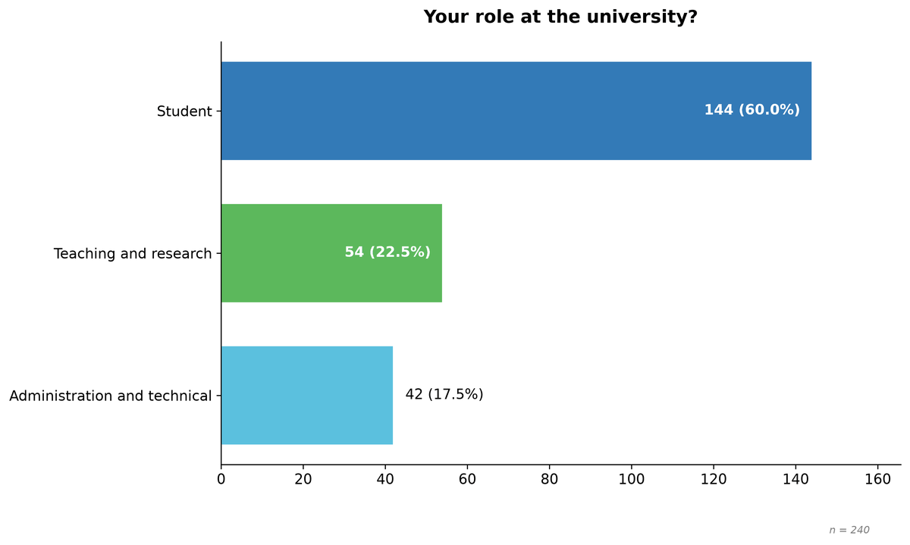

One bar per answer, with count and share of the respondents of the question (n below
the chart). Unordered answers are sorted by frequency; answers of an ordered scale keep
their order.

### Bars of an ordered scale

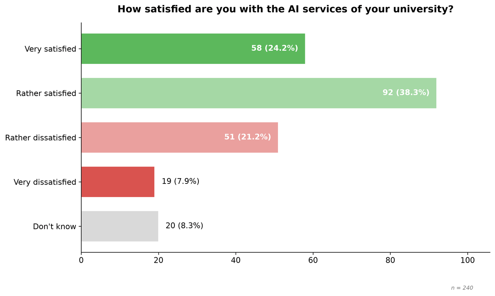

The points of the scale in their order, coloured by polarity or position. Evasive
answers are shown in light grey at their place in the list. The scale metrics (mean,
median, top and bottom box) are in the table below the chart and leave the evasive
answers out ([Methods](methods.md#23-scale-metrics-ordered-scales-and-matrix-rows)).

### Net Promoter Score

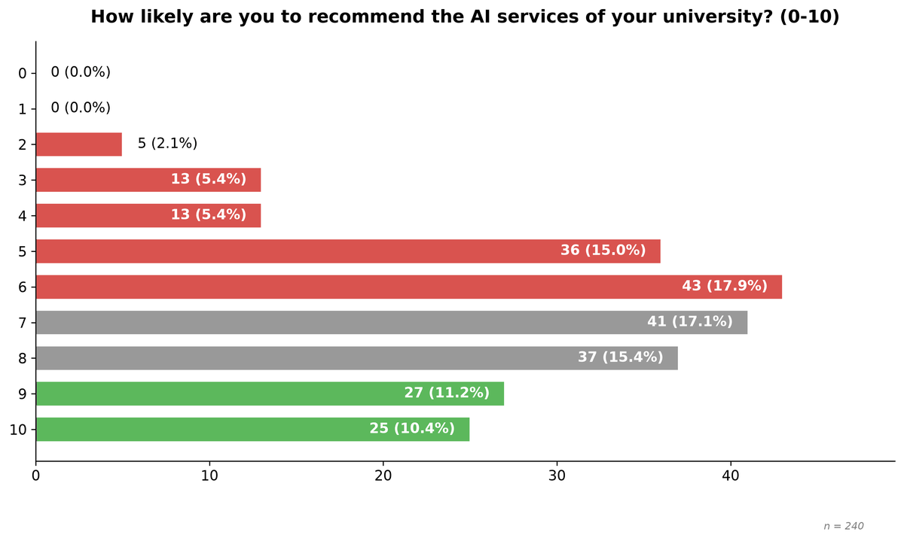

The answers 0 to 10 in their order, coloured by detractors, passives and promoters. The
score itself is in the table.

### Multiple choice

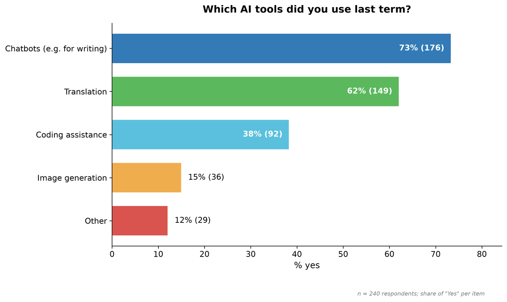

Share of the respondents who chose each option; the shares add up to more than 100 %
because respondents choose several options. The note below the chart names the base.

### Rating matrix (100 % bars)

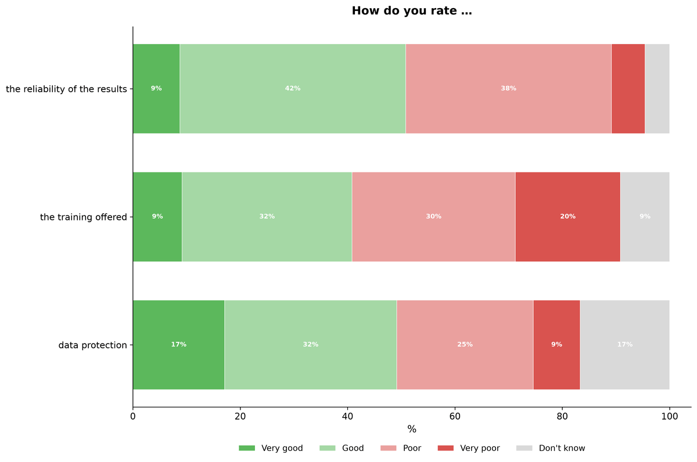

One bar per row of the matrix, divided into the shares of the scale points (100 % per
row), in the colours of the scale; evasive answers at the end in light grey.

### Ranking

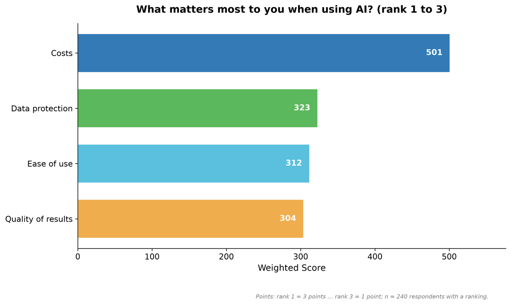

The score of each item: rank 1 of k gives k points, rank k one point
([Methods](methods.md#26-ranking)). The note below the chart states the points.

### Histogram (numeric question)

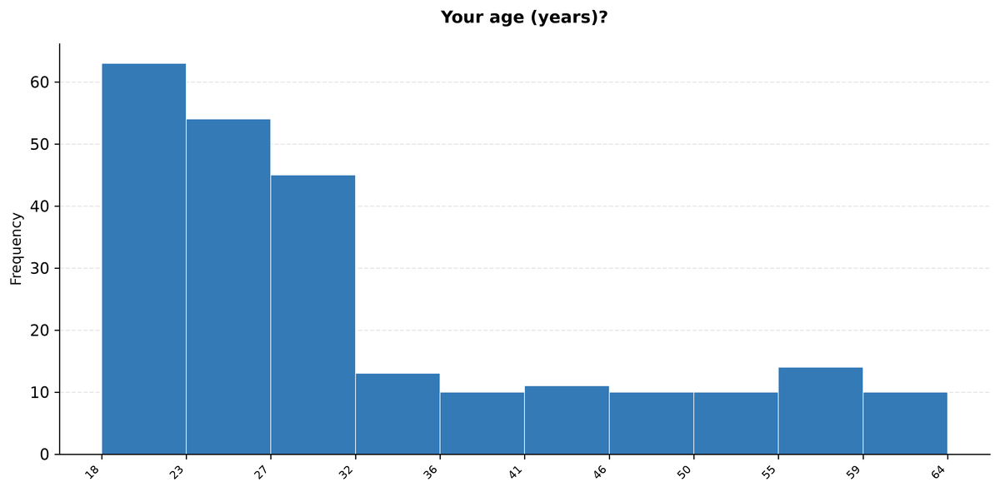

`bin_count` classes of equal width (default 10) between the smallest and the largest
valid value; the statistics are in the table.

### Number matrix

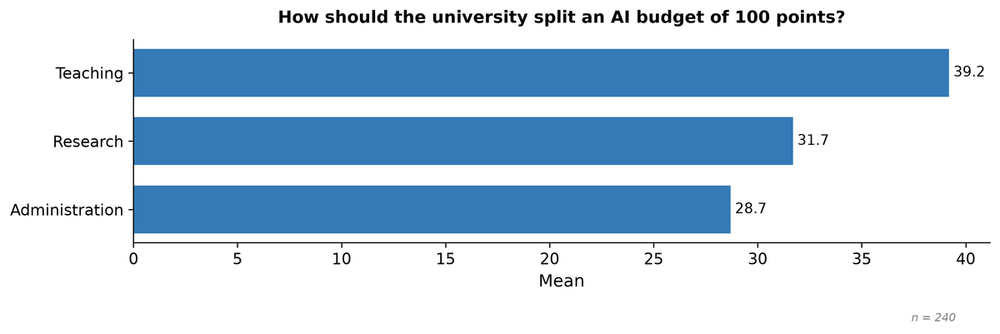

The mean of each field. With a constant sum, the share of respondents whose fields add
up to the total is in the table.

### Dates

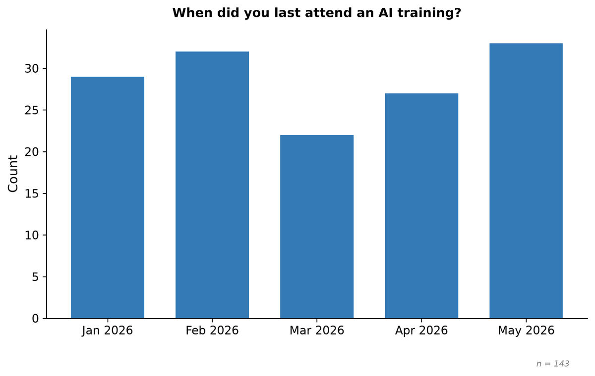

Answers per day, month or year (`date.granularity`, otherwise by the span of the dates).

## Charts by group (complete export)

A question is not compared with the groups formed from its own answers (role by role).
All charts by group keep the order and the colours of the chart of the question.

### Grouped bars

For every answer one bar per group, as the share of the respondents of the group. Suits
the comparison of one answer across the groups.

### Small multiples

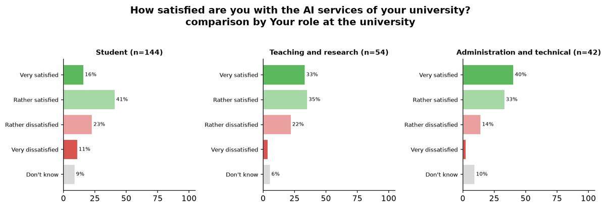

One panel per group with the distribution of the answers. Suits the comparison of the
shape of the distributions; each panel names its group and its n.

### Rating matrix by group

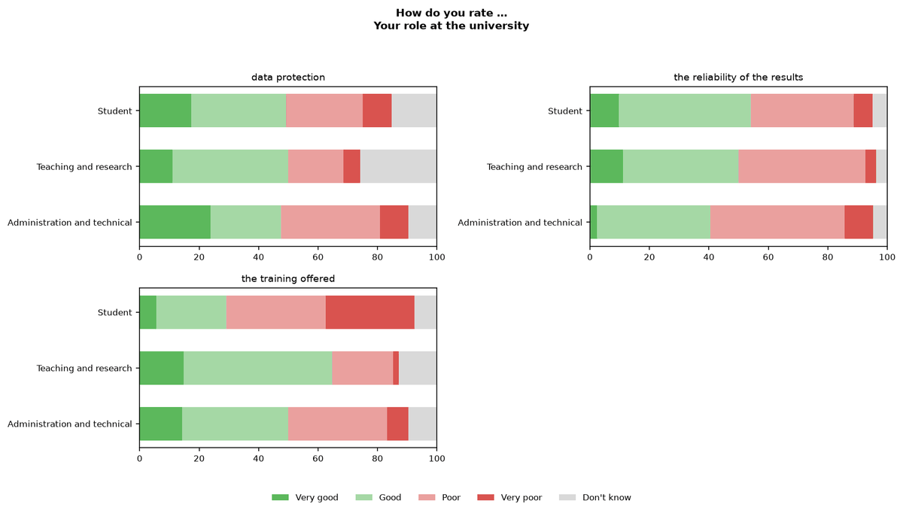

One panel per row of the matrix, in it a 100 % bar per group.

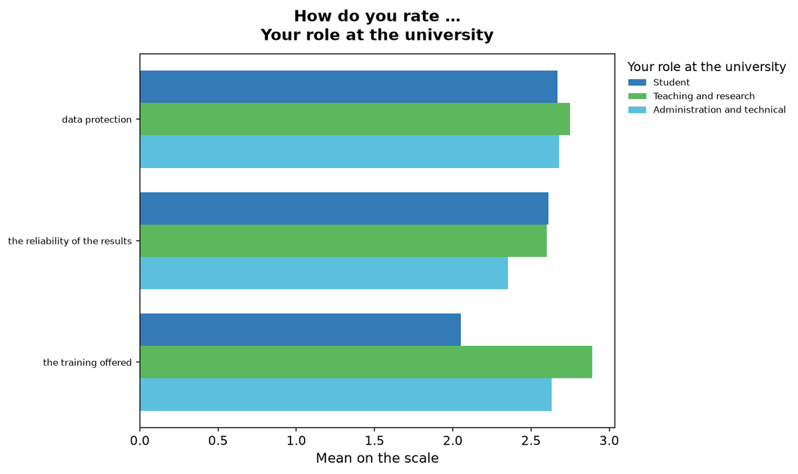

The mean on the scale per row and group; computed only when the direction of the scale
is known. `matrix_segment_chart` chooses `both` (default), `small_multiples`, `mean` or
`none`.

### Numeric question by group

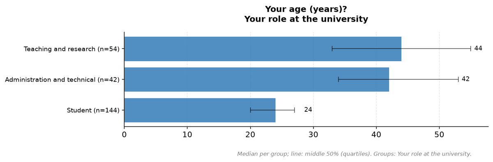

The median of each group, the line marks the middle 50 % (first to third quartile). The
median is shown because the groups are compared with the Kruskal-Wallis test, which
compares distributions.

## Dashboard

The dashboard draws its charts in the browser from the [dashboard data](dashboard-data.md),
with the same colours. Its views are described for readers in the
[Dashboard guide](dashboard-guide.md).

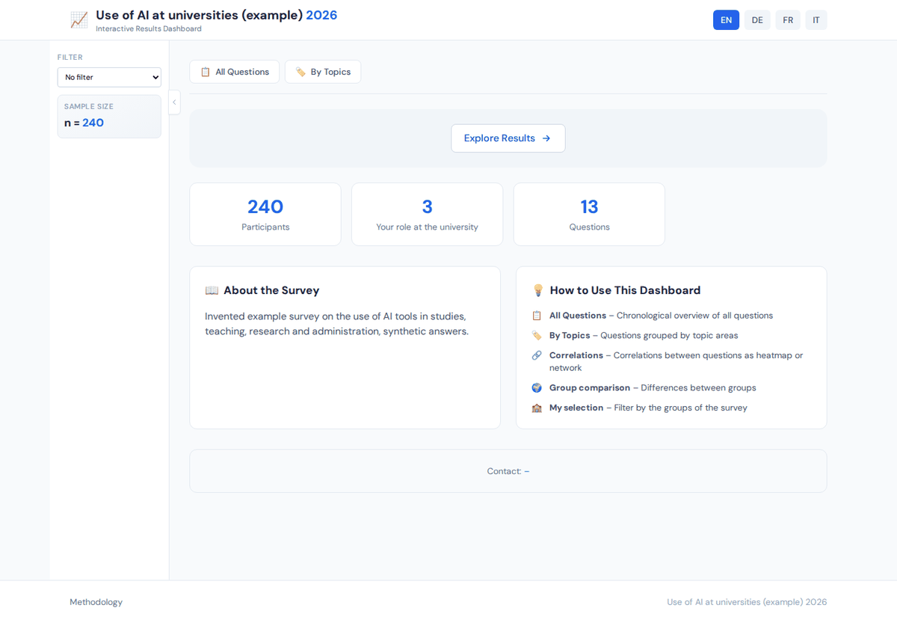

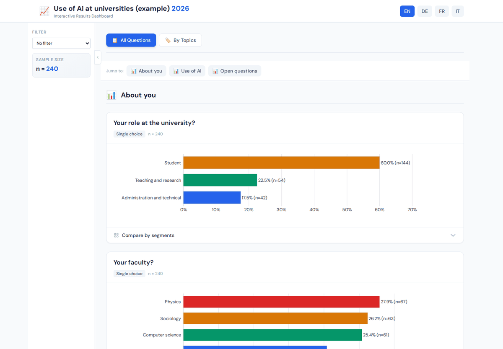

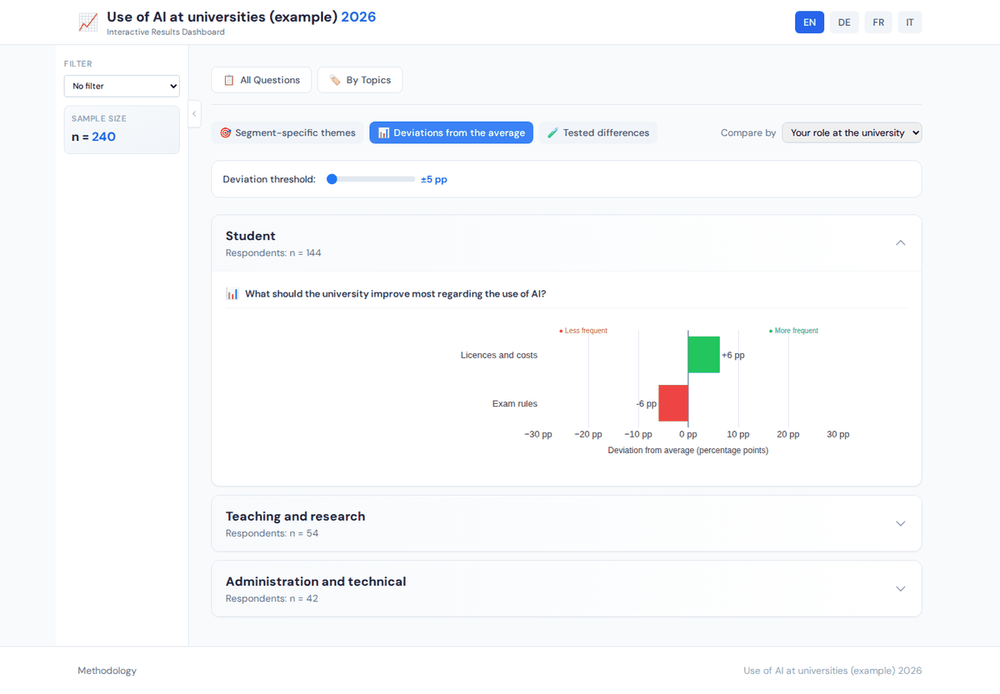

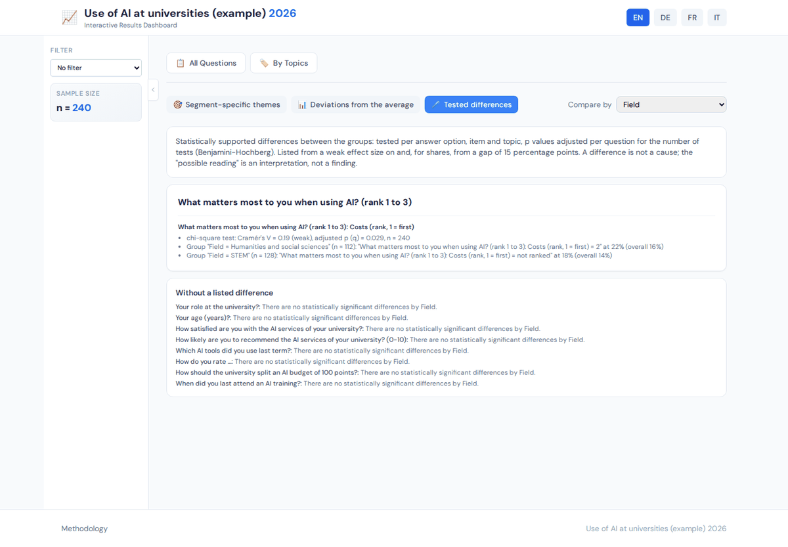

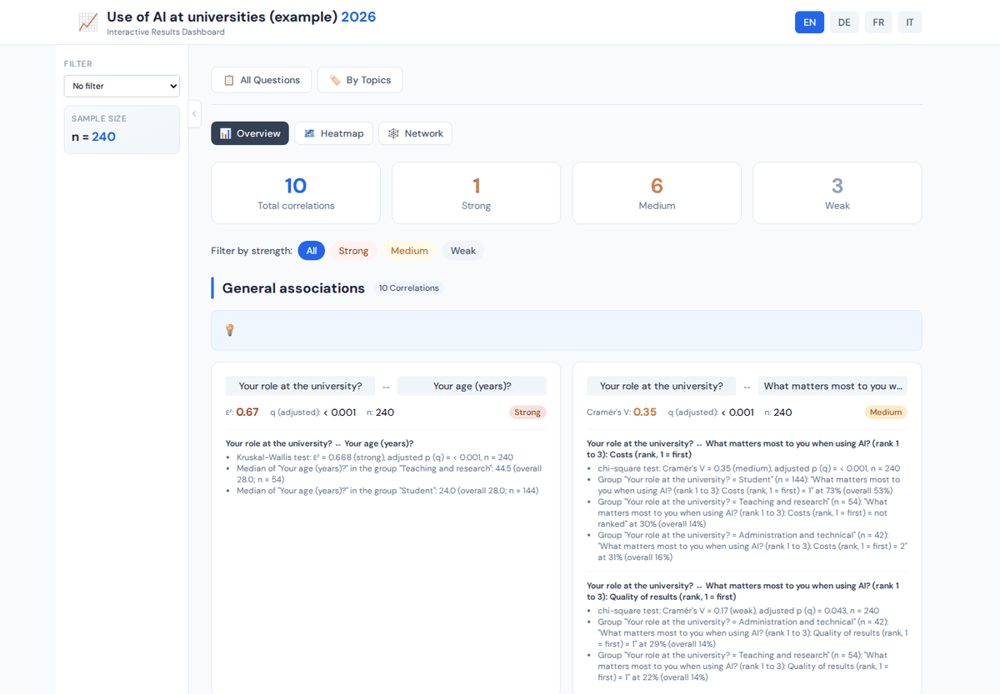

## Limits

- The charts of the reports are images (PNG); their texts cannot be edited in Word.
- Long question texts are shortened at a word boundary in the titles of charts by group.
- The chart types are fixed per question type; the configuration chooses colours
  (`option_colors`) and, for matrices by group, `matrix_segment_chart`.
