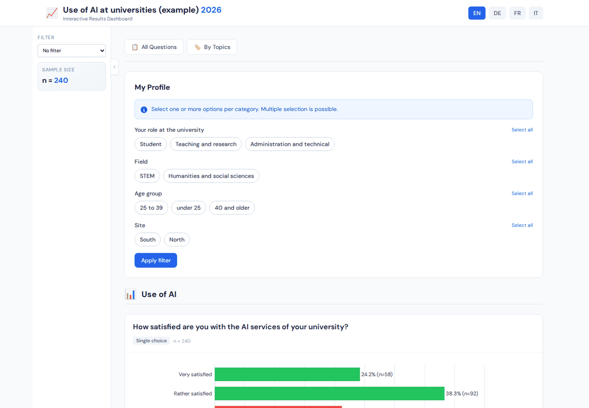

# Dashboard guide

For readers of a published dashboard: what the views show and how to read the numbers.
The images come from the English example survey.

## Page layout

- **Languages**: the buttons at the top right switch the language of all texts.
- **Filter** (left): *No filter* shows all respondents; choosing a group shows the
  results of that group only. *Sample size* shows the number of respondents of the
  current selection.
- **Views**: *All Questions*, *By Topics*, *Correlations*, *Group comparison* and *My
  selection*; the start page explains each in one line.
- **Footer**: links to the method description, the legal notice, the privacy notice
  and the contact, where the publisher has set them.

Groups with fewer respondents than the minimum of the survey (often 5) are not part of
the data at all; groups below the warning size (often 10) are marked as *Low sample
size*. Results of small groups vary strongly by chance.

## All Questions and By Topics

Every question with its chart and its numbers, in the order of the questionnaire or
grouped by topics. The note under each chart names the base (n): the respondents who
answered the question within the current filter. *Compare by segments* shows the
question for every group of a dimension side by side.

For open questions, the topics (clusters) are listed with the share of respondents who
mentioned them and typical answers. A respondent can mention several topics, so the
shares can add up to more than 100 %.

## Group comparison

Three views of the differences between the groups of one dimension (*Compare by*):

- **Segment-specific themes**: the topics of the open answers of each group, formed for
  that group alone. They describe a group; they are not compared by a test.
- **Deviations from the average**: for each group, the answers whose share differs from
  the share of all respondents by more than the threshold (adjustable), in percentage
  points: a share of 36 % against 30 % overall is a deviation of +6 percentage points. This view
  describes; it does not test. Small groups show large deviations by chance.

  

- **Tested differences**: the differences that passed a statistical test with a
  correction for the number of tests, with their effect size; questions without a
  tested difference are listed below. Only this view says whether a difference is
  unlikely to be due to chance.

  

How the tests work: [Methods, section 4](methods.md#4-statistical-tests).

## Correlations

Associations between two questions, for example between satisfaction and the use of a
tool, found by statistical tests. Each entry names the questions, the strength of the
association (weak, medium, strong), the corrected significance and a short reading.
*Heatmap* and *Network* show all associations at once. An association between two
answers does not show that one causes the other.

## My selection

Choose one or more groups per dimension (for example "Student" and "STEM") and *Apply
filter*: all views then show the respondents who match the selection. If the selection
is too small for the data, the dashboard shows the results of a partial selection and
says so (*Insufficient data for this filter combination*).

## Reading the numbers

- **Shares** are shares of the respondents who answered the question in the current
  selection (n under the chart), not of all respondents of the survey.
- **Evasive answers** ("don't know") are shown, but left out of means and scale
  metrics.
- **Colours** carry meaning only for ordered scales (green for the positive end, red for
  the negative end, grey for neutral and evasive answers); elsewhere they only tell the
  answers apart ([Charts](charts.md#colours)).
- **Texts** (summaries, readings of differences, topic names) were written with a
  language model from the computed results; the numbers are computed by the analysis.

## Limits

- The dashboard shows the respondents of the survey; it makes no statement about people
  who did not take part, and the results are not weighted.
- Deviations and segment-specific themes are descriptive; only tested differences and
  correlations come with a statistical test.
- The dashboard shows the data of one export; a later analysis of the same survey can
  differ in the topics of open answers.
